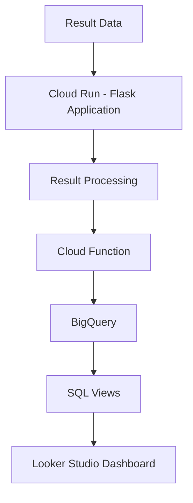

# Cloud-Based Examination Result Analytics System

A cloud-based pipeline for processing examination results, applying result-evaluation logic, and making academic performance data available for analytics and visualization.

## Overview

The **Cloud-Based Examination Result Analytics System** automates the processing and analysis of examination results using Google Cloud services. It combines a Python-based application, cloud processing components, BigQuery for analytical queries, and a dashboard-oriented visualization workflow.

The project demonstrates how cloud services can be connected to build a data-processing and analytics pipeline.

## Architecture



## Features

- **Result Processing:** Processes examination result data through a Python application.
- **Cloud Deployment:** Uses Google Cloud Run to host the application.
- **Serverless Processing:** Incorporates a Cloud Function for pipeline processing.
- **Data Analytics:** Stores and queries analytical data through BigQuery.
- **SQL Views:** Uses SQL views to support analysis of result data.
- **Dashboard Integration:** Supports visualization through Looker Studio.
- **Testing:** Includes test scripts for result-processing logic and SQL validation.
- **Report Generation:** Includes a project report and supporting architecture and workflow illustrations.

## Tech Stack

| Category | Technologies |
|---|---|
| Language | Python |
| Application | Flask |
| Cloud Platform | Google Cloud Platform |
| Deployment | Cloud Run |
| Serverless | Cloud Functions |
| Data Warehouse | BigQuery |
| Analytics | SQL |
| Visualization | Looker Studio |
| Containerization | Docker |
| Testing | Pytest |

## Project Structure

```text
exam-result-analytics-system/
├── bigquery/
│   ├── schema.json
│   └── views.sql
├── cloud_function/
│   ├── main.py
│   └── requirements.txt
├── cloud_run/
│   ├── app.py
│   ├── dashboard.html
│   ├── Dockerfile
│   └── requirements.txt
├── data_generator/
│   └── generate_results.py
├── report_build/
│   ├── build_report.py
│   └── figures/
├── tests/
│   ├── run_sql_check.py
│   └── test_logic.py
├── analytics_output.json
├── evaluated_results.csv
├── deploy.sh
├── setup_bigquery.sh
└── looker_studio_guide.md
```

## Getting Started

### 1. Clone the repository

```bash
git clone https://github.com/hiyanamdeo175-oss/exam-result-analytics-system.git
cd exam-result-analytics-system
```

### 2. Set up the Python environment

```bash
python -m venv venv
```

Activate the environment:

**Windows:**
```powershell
venv\Scripts\activate
```

**Linux/macOS:**
```bash
source venv/bin/activate
```

### 3. Install dependencies

Install dependencies for the application:

```bash
pip install -r cloud_run/requirements.txt
```

Cloud Function dependencies are listed separately in `cloud_function/requirements.txt`.

### 4. Configure Google Cloud

Deployment and BigQuery setup scripts are included in the repository.

Before deployment:

- Configure your Google Cloud project.
- Set up the required services and permissions.
- Configure authentication securely.
- Review `setup_bigquery.sh` and `deploy.sh` before executing them.

### 5. Run tests

```bash
pytest tests/
```

Review the test scripts and SQL validation requirements before running the full validation workflow.

## Documentation

- `Cloud_Based_Examination_Result_Analytics_Report.pdf` — Project report covering implementation and supporting documentation.
- `looker_studio_guide.md` — Guide for dashboard setup.
- `bigquery/views.sql` — Analytical SQL views.
- `tests/` — Testing and validation scripts.

## Future Improvements

- Add automated pipeline orchestration.
- Improve dashboard interactivity and analytical reporting.
- Introduce CI/CD for automated testing and deployment.
- Add more comprehensive monitoring and error handling.

---

**Developed as a cloud computing and data analytics project.**

